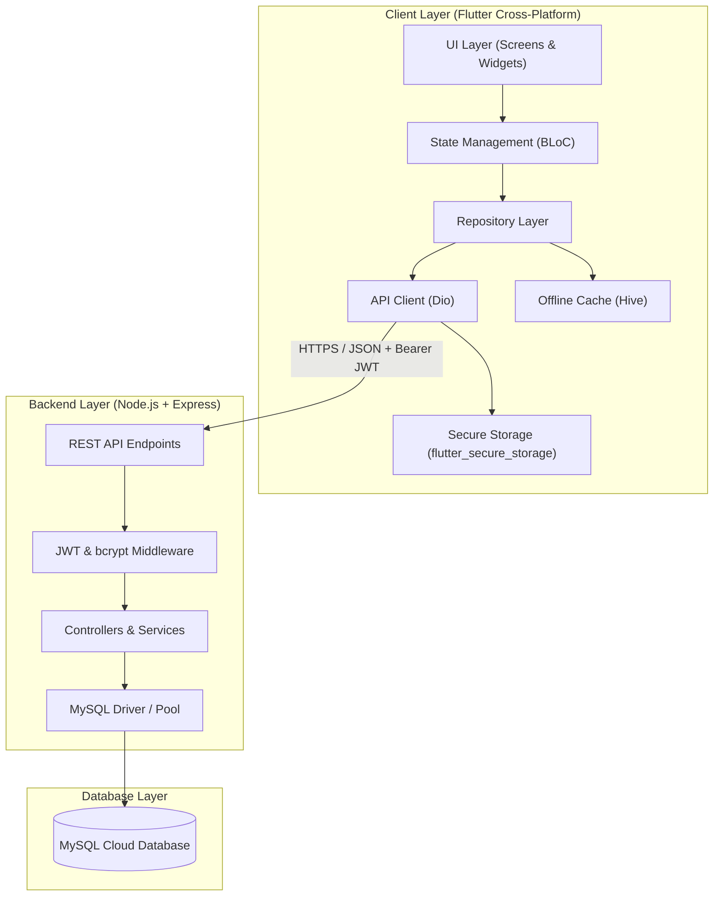

# Mono - Income & Expense Tracker Architecture Blueprint

## 1. System Architecture Overview



---

## 2. Technology Stack Breakdown

| Layer | Technology | Purpose |
| :--- | :--- | :--- |
| **Mobile App** | **Flutter 3.x / Dart 3.x** | High-performance, native UI for Android, iOS, Desktop, and Web. |
| **State Management** | **BLoC (`flutter_bloc`)** | Event-driven architecture separating business logic from UI. |
| **API Client** | **Dio** | Robust HTTP networking with interceptors for JWT injection & error handling. |
| **Secure Storage** | **`flutter_secure_storage`** | Hardware-backed keychain / Keystore encryption for JWT tokens. |
| **Offline Storage** | **Hive** | Lightweight, high-speed NoSQL key-value database for offline cache & quick startup. |
| **Backend** | **Node.js + Express** | Fast, scalable, non-blocking asynchronous RESTful API services. |
| **Authentication** | **JWT (`jsonwebtoken`) + `bcrypt`** | Stateless token auth with salt rounds (10-12) for secure password hashing. |
| **Database** | **MySQL** | ACID-compliant relational persistence for transactions, wallets, and budgets. |
| **Hosting** | **Railway / VPS (Docker + Nginx)** | Scalable cloud hosting with managed MySQL and automated deployments. |

---

## 3. Implemented Screens & BLoC Architecture

```
lib/
├── core/
│   ├── constants/
│   │   ├── app_colors.dart         # Figma theme colors (#438883, #5DACA6, #2F7E79)
│   │   ├── app_typography.dart     # Inter font styles & text hierarchies
│   │   └── app_assets.dart         # Asset references
│   ├── network/
│   │   └── api_client.dart         # Dio HTTP client with JWT interceptor
│   ├── storage/
│   │   ├── secure_storage_service.dart # Secure JWT token persistence
│   │   └── hive_service.dart       # Offline cache boxes
│   ├── theme/
│   │   └── app_theme.dart          # App-wide Material 3 theme
│   ├── widgets/
│   │   └── curved_header_painter.dart # Reusable teal header with concentric rings
│   └── routes/
│       └── app_routes.dart         # Smooth fade & slide route transitions
├── features/
│   ├── splash/presentation/screens/
│   │   └── splash_screen.dart      # Screen 1: "mono" splash with entrance animation
│   ├── onboarding/presentation/screens/
│   │   └── onboarding_screen.dart  # Screen 2: "Spend Smarter Save More" with 3D hero
│   ├── auth/
│   │   ├── bloc/
│   │   │   ├── auth_bloc.dart      # Login, Signup, Logout, CheckAuthStatus
│   │   │   ├── auth_event.dart
│   │   │   └── auth_state.dart
│   │   ├── models/
│   │   │   └── user_model.dart     # User profile entity
│   │   └── presentation/screens/
│   │       ├── login_screen.dart   # Login screen with validation & BLoC
│   │       └── signup_screen.dart  # Signup screen with terms & BLoC
│   ├── expense/
│   │   ├── bloc/
│   │   │   ├── expense_bloc.dart   # Balance, Income, Expense, Add, Filter
│   │   │   ├── expense_event.dart
│   │   │   └── expense_state.dart
│   │   └── models/
│   │       └── transaction_model.dart
│   ├── home/presentation/screens/
│   │   └── home_screen.dart        # Balance card, transactions history, send again
│   ├── statistics/presentation/screens/
│   │   └── statistics_screen.dart  # Day/Week/Month/Year filters, curved line chart
│   ├── add_expense/presentation/screens/
│   │   └── add_expense_screen.dart # Name, amount, date, invoice & custom keypad
│   ├── profile/presentation/screens/
│   │   └── profile_screen.dart     # 3D avatar, handles, options list, logout
│   └── main_nav/presentation/screens/
│       └── main_navigation_screen.dart # Bottom nav (Home, Stats, FAB (+), Profile; Wallet removed)
└── main.dart                       # MultiBlocProvider (AuthBloc + ExpenseBloc)
```

---

## 4. Screen Specifications

### 1. Login Screen ([`LoginScreen`](file:///c:/Users/CORE%20I7/Documents/Mono/lib/features/auth/presentation/screens/login_screen.dart))
- **Curved Teal Header**: Smooth gradient with concentric circles and back button.
- **Form**: Rounded input fields for email and password (with visibility eye toggle).
- **Forgot Password**: Quick action link.
- **Pill CTA Button**: "Log In" with loading spinner when `AuthLoading` and soft drop shadow.
- **Footer**: Link to Sign Up screen.

### 2. Sign Up Screen ([`SignupScreen`](file:///c:/Users/CORE%20I7/Documents/Mono/lib/features/auth/presentation/screens/signup_screen.dart))
- **Header**: "Create Account" with matching curved teal gradient.
- **Form**: Full Name, Email, Password, Confirm Password, and Terms & Conditions checkbox.
- **BLoC State**: Dispatches `SignupRequested` to `AuthBloc`.
- **Footer**: Link to Log In screen.

### 3. Main Navigation ([`MainNavigationScreen`](file:///c:/Users/CORE%20I7/Documents/Mono/lib/features/main_nav/presentation/screens/main_navigation_screen.dart))
- **Bottom Navigation Bar**:
  - `Home`: Dashboard with Total Balance card, Income/Expense summary, Recent Transactions, and Send Again avatars.
  - `Statistics`: Analytical chart, time filters, and top spendings.
  - `Center Floating Action Button (+)`: Elevated teal button opening `AddExpenseScreen`.
  - `Profile`: Account overview, 3D avatar, and settings.
  - **Wallet Tab**: Completely removed from the navigation bar per instructions.

### 4. Homepage ([`HomeScreen`](file:///c:/Users/CORE%20I7/Documents/Mono/lib/features/home/presentation/screens/home_screen.dart))
- **Greeting**: "Good afternoon, Enjelin Morgeana" with notification bell badge.
- **Total Balance Card**: Deep teal card with `$ 2,548.00`, Income (`$ 1,840.00`), and Expenses (`$ 284.00`).
- **Transactions History**: Upwork (`+$850.00`), Transfer (`-$85.00`), Paypal (`+$1,406.00`), Youtube (`-$11.99`).
- **Send Again**: Horizontal contact avatar carousel.

### 5. Statistics ([`StatisticsScreen`](file:///c:/Users/CORE%20I7/Documents/Mono/lib/features/statistics/presentation/screens/statistics_screen.dart))
- **Period Filter**: `Day`, `Week`, `Month`, `Year` segmented pill tabs.
- **Curved Chart**: Smooth spline line chart with gradient fill, dashed vertical highlight, and `$1,230` tooltip on May.
- **Top Spending**: Starbucks, Transfer (highlighted teal card), and Youtube.

### 6. Add Expense ([`AddExpenseScreen`](file:///c:/Users/CORE%20I7/Documents/Mono/lib/features/add_expense/presentation/screens/add_expense_screen.dart))
- **Card Form**: Category dropdown (Netflix, Starbucks, etc.), Amount field with "Clear", Date picker, and Invoice upload container.
- **Keypad**: Custom numeric keypad with digits `1-9`, `0`, backspace.
- **BLoC Action**: Dispatches `AddExpenseEvent` to update balance and transactions instantly.

### 7. Profile ([`ProfileScreen`](file:///c:/Users/CORE%20I7/Documents/Mono/lib/features/profile/presentation/screens/profile_screen.dart))
- **Header & 3D Avatar**: Enjelin Morgeana (`@enjelin_morgeana`).
- **Menu Options**: Invite Friends, Account Info, Personal Profile, Message Center, Security, Privacy, and Log Out with confirmation dialog.
