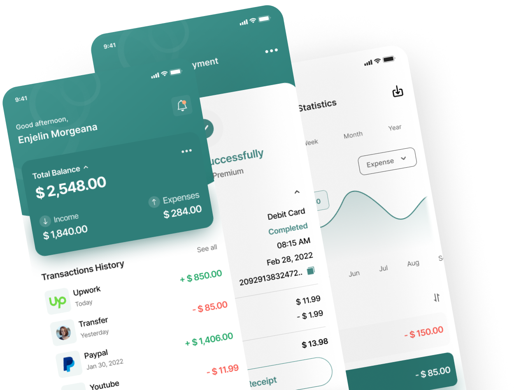
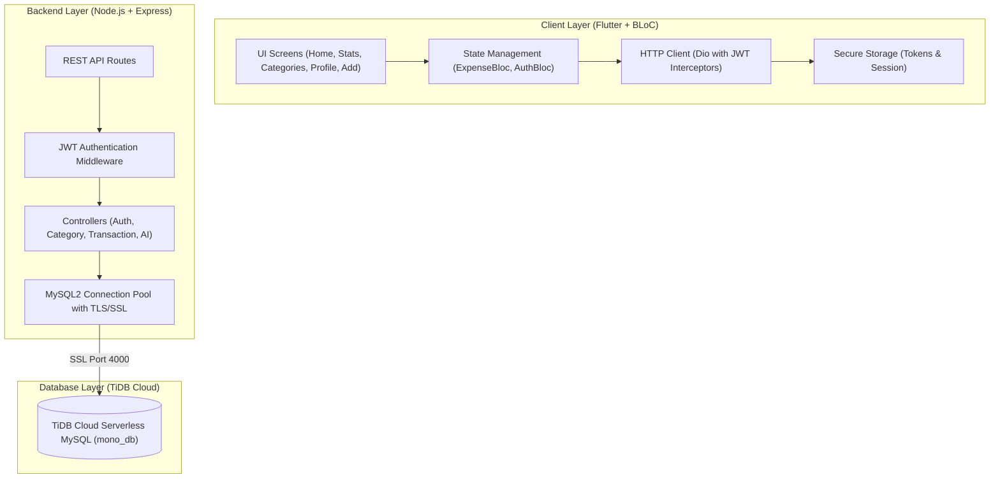

# Mono — AI-Powered Income & Expense Tracker 💸📈

<div align="center">



<br/><br/>

**A modern, production-grade personal finance and smart expense tracking ecosystem built with Flutter, BLoC, Node.js, Express, React, and TiDB Cloud (MySQL).**

[](https://betadrop.app/i/qQhg9L)
[](https://drive.google.com/drive/folders/1OgtLqLPd-3Pdtc4se1oWBNiL8xeCub8H?usp=sharing)

<br/>

[](https://flutter.dev)
[](https://dart.dev)
[](https://nodejs.org)
[](https://expressjs.com)
[](https://mono-nbt6.onrender.com/api/health)
[](https://tidbcloud.com)
[](https://bloclibrary.dev)
[-16A34A)](#)

</div>

---

## 📥 Download & Install Release APK (Android)

Get the latest production-ready build for Android:

[](https://betadrop.app/i/qQhg9L)
[](https://drive.google.com/drive/folders/1OgtLqLPd-3Pdtc4se1oWBNiL8xeCub8H?usp=sharing)

- 📲 **Instant 1-Click Install Link (BetaDrop)**: [https://betadrop.app/i/qQhg9L](https://betadrop.app/i/qQhg9L) *(Guest link: [https://betadrop.app/i/fCW2Qm](https://betadrop.app/i/fCW2Qm))*
- 📂 **Direct Google Drive Link**: [Mono Release APK Folder](https://drive.google.com/drive/folders/1OgtLqLPd-3Pdtc4se1oWBNiL8xeCub8H?usp=sharing)
- **Version**: `v1.0.0 (Production Release)`
- **Package**: `com.mono.mono_app`
- **Target OS**: Android 6.0+ (API Level 23+)
- **Cloud Backend**: Live connected to **Render** & **TiDB Cloud MySQL**

#### Quick Installation Guide:
1. Tap the **BetaDrop Instant Install Link** or scan the QR code on your phone for immediate installation.
2. Alternatively, download **`Mono_Release_v1.0.0.apk`** from Google Drive.
3. Open the downloaded file on your Android device and allow *"Install from Unknown Sources"* if prompted.
4. Launch Mono and start tracking your income and expenses smarter!

---

## 📱 Key Features & Capabilities

### 1. Dual Transaction Engine (Expense & Income)
- **Income Logging**: Dedicated Income entry mode with quick presets for **Salary Credits**, **Performance Bonuses**, **Freelance Invoices**, **Investment Returns**, and **Business Revenue**.
- **Expense Logging**: Quick expense capture with custom number keypad, date selector, category tagger, and note inputs.
- **AI Smart Receipt Scanner**: Instant sample scanning to auto-extract shop name, date, total amount, and category.

### 2. AI Financial Assistant 🤖
- Context-aware financial intelligence connected to actual transaction records.
- Instant conversational answers to:
  - *"Where did my money go this month?"*
  - *"How much can I safely spend today?"*
  - *"How can I save ₹5,000 monthly?"*
  - *"Why are my expenses increasing?"*
- Proactive spending alerts and smart recommendations based on the 50/30/20 rule.

### 3. Fully Dynamic Category Management (CRUD & Soft-Delete)
- **100% Dynamic Database Integration**: Zero hardcoded lists — all categories are fetched in real-time from the backend.
- **Full CRUD Capabilities**: Add, edit, and soft-delete categories on the fly.
- **Soft-Delete Architecture**: Deleted categories and data items are marked as `status = 'inactive'`, safely preserving historical records while excluding them from all active user queries.

### 4. Tailored for the Indian Financial System 🇮🇳
- **Strict Indian Rupee (`₹`) Formatting**: Consistent currency formatting across dashboards, balance cards, transactions, and reports.
- **Financial Year Statement Export**: Export monthly, weekly, and **Indian Financial Year (April 1 – March 31)** statements in formatted **CSV** and **PDF** formats.
- **UPI & Payment Modes**: Built-in support for UPI, Net Banking, and Debit Cards.

### 5. Responsive, Clean UI/UX
- **Left-Aligned Search Bar**: Clean start-aligned search input with instant dynamic category filtering.
- **Zero Ellipsis Overflow**: Optimized responsive layouts that prevent ugly truncation (`...`) across various device sizes.
- **Brand Identity**: Signature teal squircle launcher icon with white `mono` typography and curved header aesthetics.

---

## 🌐 Live Production Deployment

- **Backend Base URL**: [`https://mono-nbt6.onrender.com/api`](https://mono-nbt6.onrender.com/api)
- **React Admin Dashboard**: [`https://mono-nbt6.onrender.com/admin/`](https://mono-nbt6.onrender.com/admin/)
- **Health Check Status**: [`https://mono-nbt6.onrender.com/api/health`](https://mono-nbt6.onrender.com/api/health)
- **Database Engine**: TiDB Cloud Serverless MySQL (Port 4000 over TLS/SSL)

---



---

## 🗄️ Database Schema & Live Hosting

The application is powered by a high-availability **TiDB Cloud** database (`mono_db`) hosted over secure TLS/SSL:

| Table | Description |
| :--- | :--- |
| `users` | Secure user profiles with `bcrypt` password hashes and JWT authentication. |
| `categories` | Dynamic categories with `name`, `icon`, `color`, `type` (`expense`/`income`/`both`), and soft-delete `status`. |
| `transactions` | Ledger of all `income` and `expense` entries linked to categories and users. |
| `budgets` | Category budget caps with alert thresholds for monthly and weekly periods. |
| `savings_goals` | User target goals with progress tracking and deposit logs. |
| `bills_emi_debts` | Recurring and upcoming bill/EMI tracking with due dates and statuses. |
| `send_again_contacts` | Quick-transfer recipient contacts for repeat payments. |

> The complete DDL and default category seed dump is maintained in [`mono_db.sql`](file:///C:/Users/CORE%20I7/Downloads/mono_db.sql).

---

## 🚀 Getting Started

### Prerequisites
- **Flutter SDK**: `^3.19.0`
- **Node.js**: `v18+` or `v20+`
- **Android Studio / Xcode** for mobile emulation or device debugging

### 1. Backend Setup
1. Navigate to the backend directory:
   ```bash
   cd backend
   ```
2. Install dependencies:
   ```bash
   npm install
   ```
3. Configure environment variables in `backend/.env`:
   ```env
   PORT=3000
   DB_HOST=gateway01.ap-northeast-1.prod.aws.tidbcloud.com
   DB_PORT=4000
   DB_USER=FhCGq9CdLamFc3e.root
   DB_PASSWORD=your_secure_password
   DB_NAME=mono_db
   DB_SSL=true
   JWT_SECRET=your_jwt_secret_key
   JWT_EXPIRES_IN=7d
   ```
4. Start the server:
   ```bash
   node src/server.js
   ```

### 2. Flutter Mobile Setup
1. From the project root, install packages:
   ```bash
   flutter pub get
   ```
2. Run code analysis and widget tests:
   ```bash
   flutter analyze --fatal-infos lib
   flutter test
   ```
3. Run the application on your connected device or emulator:
   ```bash
   flutter run
   ```

---

## 📡 REST API Reference

| Method | Endpoint | Description |
| :--- | :--- | :--- |
| `POST` | `/api/auth/register` | Register a new user account with hashed password |
| `POST` | `/api/auth/login` | Authenticate credentials and receive JWT bearer token |
| `GET` | `/api/auth/me` | Fetch authenticated user profile data |
| `GET` | `/api/categories` | Retrieve all active user & system categories |
| `POST` | `/api/categories` | Create a custom category (`expense` or `income`) |
| `PUT` | `/api/categories/:id` | Update category details (name, icon, color, type) |
| `DELETE`| `/api/categories/:id` | Soft-delete category (`status = 'inactive'`) |
| `GET` | `/api/transactions/dashboard` | Aggregated balance, income, expenses, and recent records |
| `POST` | `/api/transactions` | Record an income or expense transaction |
| `DELETE`| `/api/transactions/:id` | Soft-delete a transaction |
| `GET` | `/api/transactions/statistics` | Dynamic chart data grouped by Day, Week, Month, or Year |
| `GET` | `/api/transactions/export` | Download CSV statement for Monthly, Weekly, or Financial Year |
| `POST` | `/api/ai/ask` | Query AI Financial Assistant with contextual spending data |

---

## 📄 License
This project is open-source under the [MIT License](LICENSE).
